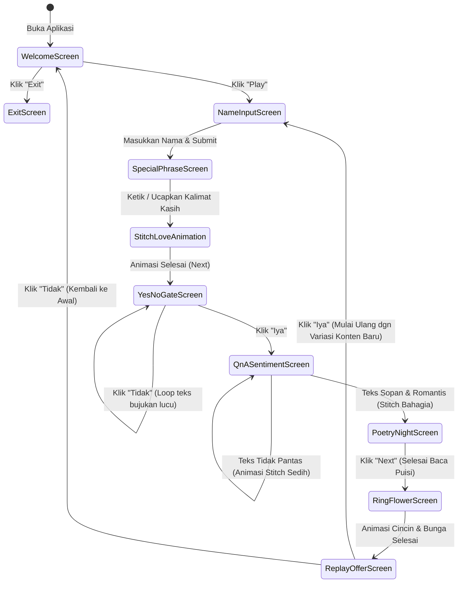

# 🌌 Dokumen Kebutuhan Sistem (Software Requirements Specification)
## Proyek: Aplikasi Penyenang & Penenang Pasangan ("Lilo & Stitch Calm Night")
**Nama Dokumen:** `penenangdanpenyenang.md`  
**Versi:** 1.0.0  
**Status:** Approved / Siap Implementasi  
**Tanggal:** 2026-10-01  

---

## 📑 Daftar Isi
1. [Pendahuluan & Gambaran Umum](#1-pendahuluan--gambaran-umum)
2. [Konsep Desain & Estetika Visual](#2-konsep-desain--estetika-visual)
3. [Alur Pengguna & State Diagram](#3-alur-pengguna--state-diagram)
4. [Spesifikasi Kebutuhan Fungsional (Functional Requirements)](#4-spesifikasi-kebutuhan-fungsional)
   - [FR-01: Welcome Screen (Layar Pembuka & Kontrol Utama)](#fr-01-welcome-screen-layar-pembuka--kontrol-utama)
   - [FR-02: Input Nama Pasangan & Maskot Stitch Bergerak](#fr-02-input-nama-pasangan--maskot-stitch-bergerak)
   - [FR-03: Kalimat Cinta & Animasi Stitch Memegang Love Besar](#fr-03-kalimat-cinta--animasi-stitch-memegang-love-besar)
   - [FR-04: Gerbang Interaktif "Iya" vs "Tidak" (Looping Bujuk Manis)](#fr-04-gerbang-interaktif-iya-vs-tidak-looping-bujuk-manis)
   - [FR-05: Tanya Jawab Sentimen Positif & Reaksi Stitch](#fr-05-tanya-jawab-sentimen-positif--reaksi-stitch)
   - [FR-06: Ruang Puisi Malam Indah & Animasi Bintang Jatuh](#fr-06-ruang-puisi-malam-indah--animasi-bintang-jatuh)
   - [FR-07: Animasi Romantis Pemberian Cincin & Buket Bunga](#fr-07-animasi-romantis-pemberian-cincin--buket-bunga)
   - [FR-08: Penutup & Dynamic Content Replay Engine](#fr-08-penutup--dynamic-content-replay-engine)
5. [Spesifikasi Kebutuhan Non-Fungsional (Non-Functional Requirements)](#5-spesifikasi-kebutuhan-non-fungsional)
6. [Arsitektur Teknis & Struktur Data Konten](#6-arsitektur-teknis--struktur-data-konten)
7. [Panduan Desain Antarmuka (UI/UX Storyboard)](#7-panduan-desain-antarmuka-uiux-storyboard)
8. [Rencana Implementasi & Pengujian](#8-rencana-implementasi--pengujian)

---

## 1. Pendahuluan & Gambaran Umum

### 1.1 Latar Belakang
Dalam suatu hubungan, ada kalanya pasangan mengalami hari yang melelahkan, stres, sedih, atau cemas (*overthinking*). Aplikasi ini dirancang sebagai tempat perlindungan emosional digital (*digital comforting sanctuary*), yang secara khusus dirancang untuk menenangkan pikiran, memberikan hiburan yang menggemaskan, menghangatkan hati, dan mempererat ikatan cinta melalui pengalaman interaktif yang imersif.

### 1.2 Tujuan Aplikasi
1. Memberikan atmosfer yang menenangkan jiwa (*calming & soothing ambiance*) dengan estetika malam berbintang dan aurora borealis.
2. Menghadirkan karakter maskot kartun Stitch biru animasi yang lucu, menggemaskan, dan ekspresif.
3. Menghadirkan alur interaksi psikologis positif (afirmasi nama, kalimat kasih sayang, puisi romantis, validasi perasaan, hingga simbol cincin dan bunga).
4. Menghadirkan pengalaman interaktif yang tidak membosankan melalui fitur pilihan dinamis (*looping* kata bujukan manis dan bank kata yang berganti setiap kali diulang).

### 1.3 Target Pengguna
- Pasangan kekasih / suami-istri yang ingin melepas penat, merayakan momen romantis, atau mencari ketenangan sebelum tidur.

---

## 2. Konsep Desain & Estetika Visual

### 2.1 Tema & Suasana (Atmosphere)
- **Nuansa Utama:** *Deep Calm Night Sky with Ethereal Aurora Borealis* (Langit malam tenang dengan pancaran aurora warna cyan/magenta lembut).
- **Elemen Langit:** 
  - Bintang-bintang berkelap-kelip (*twinkling stars*).
  - Bintang jatuh sesekali meluncur di latar belakang (*shooting stars / meteors*).
  - Awan malam transparan yang bergeser perlahan (*drifting nebula clouds*).
- **Gaya Desain:** *Glassmorphism Modern* dengan tepian berpendar (*glow effects*), rounded corners yang nyaman, serta tipografi elegan.

### 2.2 Prinsip Warna Ramah Mata (Eye-Comfort & Anti-Glare Architecture)
Untuk menjamin aplikasi terasa menenangkan, tidak membuat mata lelah saat digunakan di malam hari (*night-time eye strain*), dan tidak membosankan:
1. **Low Blue-Light Fatigue & Anti-Glaring:** Menghindari warna neon 100% saturasi tinggi atau kontras putih murni (`#ffffff`) di atas hitam pekat. Menggunakan turunan *warm starlight ivory*, *soft pastels*, dan *deep muted twilight*.
2. **Harmonious Soft Contrast:** Rasio kontras teks dibuat nyaman dibaca tanpa menusuk retina, menggunakan teknik pendaran lembut (*soft ambient glow with gaussian blur*) alih-alih garis tajam.
3. **Atmospheric Dynamic Transition (Anti-Bosan):** Setiap frame memiliki tema pendaran warna (*ambient mood*) yang berganti secara perlahan (*smooth transition 1.5s - 2.5s*) saat berpindah layar, sehingga mata tetap segar, rileks, dan terpesona.

### 2.3 Spesifikasi Kombinasi Warna Estetik untuk Setiap Frame
Berikut adalah kurasi palet warna estetik ramah mata yang dirancang khusus untuk masing-masing frame:

| Frame / Layar | Palet Latar & Kartu (Base & Glass) | Aksen Utama & Stitch | Warna Teks & Interaksi | Kesan Psikologis Emosional |
| :--- | :--- | :--- | :--- | :--- |
| **Frame 1: Welcome Screen** | **Deep Midnight Indigo** (`#0b1021`) + Awan kabut tipis toska gelap (`rgba(22, 53, 77, 0.4)`) | **Muted Stitch Blue** (`#4d88df`), pendaran aurora lembut (`#38bdf8` opasitas 30%) | **Warm Moonlit Ivory** (`#f3f4f6`) & Tombol Play Pastel Cyan (`#38bdf8`) | Tenang, damai, mengundang rasa aman seketika. |
| **Frame 2: Input Nama** | **Twilight Slate Violet** (`#121326`) + Kartu Glassmorphism Frost (`rgba(255, 255, 255, 0.05)`) | **Soft Stitch Denim** (`#5580e9`), Telinga Stitch Soft Rose (`#f3a6b2`) | **Pastel Lavender Mist** (`#e0e7ff`), Border input pendaran lilac (`#a78bfa`) | Menggemaskan, hangat, memicu rasa penasaran manis. |
| **Frame 3: Kalimat Kasih & Stitch Love** | **Deep Velvet Plum** (`#171124`) + Pendaran hangat magenta redup (`#5c2444`) | **Blushing Rose-Coral** (`#f87171` lembut) untuk Love besar, Stitch memeluk erat | **Warm Candlelight Cream** (`#fef3c7`), Tombol Lanjut Soft Coral (`#fb7185`) | Penuh kasih sayang, menghangatkan dada, tidak menyilaukan. |
| **Frame 4: Gerbang "Iya" vs "Tidak"** | **Muted Deep Navy** (`#0e1529`) + Nebula debu bintang ungu redup | **Playful Stitch Wink** (`#4880e2`), Tombol "Iya" Sage Mint (`#34d399`), Tombol "Tidak" Dusty Coral (`#f87171`) | **Starlight Pearl** (`#f1f5f9`), efek rayuan teks berganti lembut | Ceria, santai, lucu, tanpa rasa tertekan atau kaku. |
| **Frame 5: Tanya Jawab Sentimen** | **Reflective Deep Twilight** (`#101726`) + Gradasi hening biru samudra gelap | **Stitch Sedih:** Slate Muted Blue (`#64748b`) & Kristal Air Mata (`#93c5fd`). **Stitch Bahagia:** Soft Sky Blue (`#60a5fa`) | **Soft Feather Grey** (`#cbd5e1`), border input Glow Toska Lembut (`#2dd4bf`) | Reflektif, menenangkan pikiran overthinking, aman untuk curhat. |
| **Frame 6: Puisi & Bintang Jatuh** | **Cosmic Midnight Obsidian** (`#080c17`) + Aurora Borealis menari halus (`#0e4b5b` ke `#4a1d63`) | **Shooting Star Trail:** Warm Golden Shimmer (`#fde68a`), Partikel Stardust Emas Halus | **Warm Amber-Ivory** (`#fef9c3` - menyerupai baca buku lampu temaram) | Hipnotis ketenangan mendalam, emosional, sangat romantis. |
| **Frame 7: Hadiah Cincin & Buket Bunga** | **Royal Midnight Amethyst** (`#140f24`) + Kilau cahaya perhiasan lembut | **Champagne Gold** (`#fbbf24` soft shimmer), **Pastel Rose Bouquet** (`#f472b6` & `#a7f3d0` daun sage) | **Luminous Opal** (`#fdf4ff`), Aksen pita satin baby-blue | Mewah, estetik, menyentuh relung hati, sangat memanjakan mata. |
| **Frame 8: Penutup & Replay Engine** | **Gentle Twilight Horizon** (`#0f172a`) + Gradasi fajar redup lembut (`#2a203d`) | **Stitch Flying Kiss** (`#4f8df5`), Partikel hati kecil pastel pastel lembut | **Soft Velvet Cream** (`#f8fafc`), Tombol Replay Soft Violet (`#818cf8`) | Kepuasan emosional, nyaman untuk tidur atau dinikmati kembali. |

### 2.4 Tipografi & Keterbacaan Santai
- **Judul & Puisi:** Font serif modern / kaligrafi romantis yang hangat (contoh: *Playfair Display*, *Cinzel Decorative*, atau *Great Vibes* via Google Fonts).
- **Teks Narasi & Form:** Font sans-serif yang bersih, bulat, dan mudah dibaca (contoh: *Quicksand*, *Outfit*, atau *Nunito*).
- **Warna Teks:** Tidak menggunakan putih 100% murni (`#ffffff`), melainkan warna *off-white/cream* hangat seperti `#f3f4f6`, `#fef9c3`, atau `#fdf4ff` untuk mencegah ketegangan otot mata (*eye fatigue*).

### 2.5 Maskot Karakter: Stitch Biru Bergerak
- **Karakter:** Stitch (karakter biru lucu dengan telinga besar dan mata bulat berbinar).
- **Palet Warna Karakter:** Menggunakan palet Stitch berkarakter kartun modern yang teduh (Badan: `#447dd8` hingga `#5b93ea`, Perut & Sekitar Mata: `#84b6f4`, Telinga Dalam: `#ea93a5`), sehingga tetap selaras dengan suasana malam dan tidak memantulkan warna mencolok.
- **Status State Animasi:**
  1. *Stitch Melambai / Idle Lucu:* Digunakan di Welcome Screen & Menu Akhir.
  2. *Stitch Mengintip di Atas Input Box:* Menatap penasaran ke kolom nama.
  3. *Stitch Memegang Love Besar:* Memeluk hati pink/merah berdenyut penuh kasih.
  4. *Stitch Sedih / Menangis:* Telinga turun, mata berkaca-kaca saat ada kata tidak sopan.
  5. *Stitch Bahagia / Berbinar:* Melompat ceria dengan kembang api bintang saat menerima kalimat manis.
  6. *Stitch Membawa Cincin & Buket Bunga:* Berlutut atau menyodorkan hadiah romantis dengan senyuman manis.

---

## 3. Alur Pengguna & State Diagram

Berikut adalah alur navigasi dari awal hingga selesai:



---

## 4. Spesifikasi Kebutuhan Fungsional

### FR-01: Welcome Screen (Layar Pembuka & Kontrol Utama)
- **Deskripsi:** Layar pertama yang menyambut pengguna dengan suasana syahdu dan tenang.
- **Kebutuhan Detail:**
  1. Latar belakang kanvas langit malam gelap yang dihiasi efek aurora bergelombang lembut dan kelap-kelip bintang.
  2. Tulisan pembuka yang menenangkan hati (misalnya: *"Tarik nafas pelan-pelan... tinggalkan semua lelahmu di luar sini, malam ini hanya ada kedamaian untukmu"*).
  3. Maskot Stitch biru yang bergerak melambaikan tangan dengan ramah dan menggemaskan.
  4. **Tombol "Play":** Tombol estetik berpendar (*neon pulse*) untuk memulai perjalanan.
  5. **Tombol "Exit":** Tombol alternatif untuk menutup aplikasi atau menampilkan layar pamit (*farewell screen*) yang hangat.
  6. Audio pengiring: Tombol toggle musik latar (*BGM Ambient Lofi / Night Calm Piano*) dengan ikon volume yang lembut.

### FR-02: Input Nama Pasangan & Maskot Stitch Bergerak
- **Deskripsi:** Halaman untuk mempersonalisasi seluruh pengalaman menggunakan nama pasangan.
- **Kebutuhan Detail:**
  1. Di bagian atas input field, terdapat animasi karakter Stitch biru yang bergerak interaktif (misalnya kepalanya bergerak menoleh atau mengintip dari atas kotak input).
  2. Pertanyaan/instruksi manis: *"Boleh sebutkan nama seseorang yang paling berharga di hatiku?"*.
  3. Input box transparan bergaya *glassmorphism* dengan placeholder bersinar lembut.
  4. Validasi input: Nama tidak boleh kosong dan minimal 2 karakter.
  5. Tombol konfirmasi "Mulai Petualangan Kita ✨".
  6. Nama yang dimasukkan akan disimpan dalam sesi untuk digunakan pada puisi dan dialog selanjutnya.

### FR-03: Kalimat Cinta & Animasi Stitch Memegang Love Besar
- **Deskripsi:** Fitur pengikat emosi di mana pengguna diminta mengungkapkan atau menyetujui sebuah kalimat sakral/manis.
- **Kebutuhan Detail:**
  1. Menampilkan teks panduan: *"Katakan atau ketik satu kalimat ini dengan tulus di dalam hatimu: 'Aku berharga dan aku disayangi sepenuh jiwa'"*.
  2. Kolom pengetikan interaktif atau tombol pengucapan ikrar (*"Aku Siap Mengatakannya"*).
  3. Ketika kalimat tersebut diselesaikan/dikonfirmasi, memicu transisi animasi instan:
     - Stitch biru memunculkan hati (*Love*) besar bercahaya merah muda/merah saga dari balik punggungnya.
     - Hati tersebut berdenyut (*heartbeat animation*) dengan partikel cahaya cinta di sekelilingnya.
  4. Muncul tombol "Lanjut Sayang ❤️" setelah animasi bermain selama 2 detik.

### FR-04: Gerbang Interaktif "Iya" vs "Tidak" (Looping Bujuk Manis)
- **Deskripsi:** Fitur lucu dan menggemaskan yang meminta konfirmasi pasangan untuk melangkah lebih dalam.
- **Kebutuhan Detail:**
  1. Pertanyaan: *"Maukah kamu membuka rahasia malam terindah bersamaku?"*.
  2. Terdapat dua tombol: **"Iya"** dan **"Tidak"**.
  3. **Jika menekan "Tidak":**
     - Halaman **tidak akan berpindah**.
     - Teks pertanyaan dan ekspresi Stitch akan berubah memelas dengan kata-kata bujukan yang berganti secara dinamis (*looping*), contoh:
       - *Loop 1:* "Yakin nih gak mau? Nanti nyesel lho... 🥺"
       - *Loop 2:* "Masa ditolak sih? Stitch udah rapi gini pakai dasi kupu-kupu! 😢"
       - *Loop 3:* "Ayolah pencet 'Iya' dong sayang, cuma sekali klik aja kok~ 💕"
       - *Loop 4:* "Tombol 'Tidak'-nya ngambek, harus pencet 'Iya' pokoknya! 😜"
     - Tombol "Tidak" bisa dibuat bergerak mengecil atau bergeser lucu (*playful dodge effect*).
  4. **Jika menekan "Iya":**
     - Suara efek lonceng lembut (*sparkle sound effect*).
     - Mengantar pengguna langsung ke modul berikutnya.

### FR-05: Tanya Jawab Sentimen Positif & Reaksi Stitch
- **Deskripsi:** Interaksi reflektif di mana pengguna dapat mengungkapkan apa yang dirasakan, namun sistem memfilter agar tetap damai, sopan, dan penuh cinta.
- **Kebutuhan Detail:**
  1. Pertanyaan pemicu emosi yang menenangkan, contoh: *"Apa satu hal indah yang ingin kamu sampaikan atau rasakan malam ini?"*.
  2. Kolom teks untuk mengetikkan jawaban.
  3. **Filter Validasi Sentimen & Kesopanan:**
     - Sistem memiliki kamus deteksi kata kasar, toksik, atau tidak pantas (*profanity / negative words filter*).
     - Hanya menerima input yang sopan, menenangkan, atau bernada romantis.
  4. **Kondisi Kata Tidak Pantas:**
     - Animasi Stitch berubah menjadi **Stitch Sedih/Menangis** (telinga layu, menangis dengan air mata berkilau).
     - Pesan teguran halus: *"Eh, Stitch jadi sedih... Di sini tempat kita menenangkan hati, gunakan kata-kata yang penuh kehangatan yaa... 🥺💙"*.
     - Pengguna diminta mengetik ulang.
  5. **Kondisi Kata Sopan / Romantis:**
     - Animasi Stitch tersenyum lebar, bersorak gembira, melompat dengan taburan bintang emas.
     - Pesan apresiasi manis: *"Kata-katamu begitu menghangatkan hati..."*.
     - Melanjutkan secara otomatis ke ruang puisi malam.

### FR-06: Ruang Puisi Malam Indah & Animasi Bintang Jatuh
- **Deskripsi:** Klimaks penenang jiwa melalui karya puisi yang menyejukkan hati di bawah pemandangan langit malam.
- **Kebutuhan Detail:**
  1. Latar belakang berubah menjadi pemandangan langit malam yang amat mempesona:
     - Aurora menari perlahan dengan gradasi warna biru, ungu, dan toska.
     - Efek animasi hujan bintang jatuh (*shooting star streak effects*) melintasi layar secara berkala.
  2. Teks puisi ditampilkan dengan efek ketik lembut (*typewriter*) atau *fade-in line by line*.
  3. Puisi memuat nama pasangan yang telah diinput pada FR-02.
  4. Bingkai puisi dihiasi ornamen bintang berpendar (*glowing stardust border*).
  5. Tombol **"Next 🌠"** yang muncul di bagian bawah setelah puisi selesai dibaca hingga baris terakhir.

### FR-07: Animasi Romantis Pemberian Cincin & Buket Bunga
- **Deskripsi:** Kejutan visual penuh romansa dan estetika tinggi.
- **Kebutuhan Detail:**
  1. Transisi ke sebuah kotak perhiasan mewah dan buket bunga cantik di tengah layar.
  2. Animasi kotak cincin terbuka perlahan:
     - Cincin berkilau dengan pantulan cahaya berlian (*lens flare & sparkle particles*).
  3. Bersamaan dengan itu, buket bunga mawar/bunga lavender mekar perlahan dengan warna lembut aesthetic.
  4. Stitch muncul di samping membawa pita bertuliskan kalimat janji manis: *"Untukmu yang selalu istimewa, hari ini, esok, dan selamanya"*.
  5. Pengguna dapat menyentuh/klik cincin atau bunga untuk memicu efek pendaran cahaya tambahan.

### FR-08: Penutup & Dynamic Content Replay Engine
- **Deskripsi:** Menu akhir yang memberikan pilihan untuk mengulang pengalaman dengan konten segar atau kembali istirahat.
- **Kebutuhan Detail:**
  1. Menampilkan pertanyaan hangat: *"Apakah kamu ingin melihat hal indah yang lain lagi bersamaku?"*.
  2. Dua tombol pilihan utama: **"Iya"** dan **"Tidak"**.
  3. **Jika memilih "Iya":**
     - Aplikasi mereset perjalanan kembali ke alur interaktif dengan **Bank Data Dinamis (Variation Engine)**.
     - Puisi yang ditampilkan pada putaran berikutnya akan menggunakan bait puisi baru (Bukan puisi yang sama).
     - Kalimat bujukan pada gerbang pilihan dan respons Stitch akan berganti dengan variasi baru yang segar.
  4. **Jika memilih "Tidak":**
     - Aplikasi kembali ke halaman awal (Welcome Screen) dalam keadaan tenang.
     - Stitch memberikan animasi ciuman terbang (*flying kiss*) atau melambaikan tangan dengan ucapan: *"Selamat beristirahat sayang, mimpikan hal-hal indah ya... 🌙💤"*.

---

## 5. Spesifikasi Kebutuhan Non-Fungsional

| Kategori | Parameter | Spesifikasi & Standar |
| :--- | :--- | :--- |
| **Estetika (Aesthetics)** | *Visual Appeal & Anti-Bosan* | Menerapkan efek glassmorphism, gradasi aurora halus, partikel bintang CSS/Canvas, transisi tema warna antar frame (1.5s - 2.5s) agar pengguna tidak jenuh, serta animasi Stitch 60 FPS tanpa jeda kaku. |
| **Kenyamanan Mata (Eye Comfort)** | *Anti-Glare & Ergonomics* | Menjamin warna ramah mata di malam hari: tidak ada neon tajam, menggunakan palet warm starlight/pastel muted, kontras rasio WCAG AAA yang lembut tanpa silau (*zero flashbang effect*). |
| **Responsivitas** | *Cross-Device* | Tampilan harus adaptif dan sempurna dibuka di layar HP (Mobile Smartphone), Tablet, maupun Laptop/Desktop (Responsive Flexbox/Grid). |
| **Performa** | *Load Time & Asset* | Waktu pemuatan awal di bawah 2 detik. Aset animasi Stitch dioptimasi (SVG/CSS sprite/WebP animasi) agar ringan dan tidak lag. |
| **Interaktivitas** | *Micro-interactions* | Setiap tombol memiliki efek *hover glow*, *active bounce*, dan suara klik lembut (*haptic/audio feedback* opsional). |
| **Privasi Emosional** | *Data Retention* | Nama dan respon pengguna disimpan secara aman di memori lokal peramban (*LocalStorage / SessionState*) tanpa dikirim ke server pihak ketiga. |

---

## 6. Arsitektur Teknis & Struktur Data Konten

### 6.1 Teknologi yang Direkomendasikan
- **Frontend Core:** HTML5 Semantik, Vanilla CSS3 (Custom Properties & Keyframe Animation), Modern JavaScript (ES6+ Modules).
- **Animasi Visual:**
  - Canvas 2D API untuk sistem partikel bintang berkelap-kelip & bintang jatuh dinamis.
  - CSS Keyframes & SVG Filters untuk efek pendaran aurora (*aurora borealis wave effect*).
  - SVG / WebP Animation untuk karakter Stitch dengan multi-state ekspresi.
- **Audio Engine:** Web Audio API / HTML5 Audio dengan kontrol volume bertahap (*fade-in / fade-out* otomatis).

### 6.2 Skema Data Konten Dinamis (Content Variation Bank)
Aplikasi memiliki struktur data array JavaScript agar setiap perulangan (*replay*) menyajikan kata-kata dan puisi berbeda:

```javascript
const CONTENT_VARIATIONS = {
  // Bank Puisi Berbeda untuk Setiap Putaran Replay
  poems: [
    {
      id: 1,
      theme: "Bintang & Ketenangan",
      lines: [
        "Di antara bentangan langit malam yang hening,",
        "Namamu berbisik lembut mengusir bising.",
        "Kala lelah merayap di pundak manismu,",
        "Ingatlah, semesta dan aku selalu menjagamu.",
        "Tidurlah dengan damai, {nama}, bintang-bintang ini milikmu."
      ]
    },
    {
      id: 2,
      theme: "Pelukan & Rumah",
      lines: [
        "Malam tidak pernah benar-benar dingin,",
        "Selama rindu ini masih terhembus angin.",
        "Untukmu, {nama}, tempat segala resah reda,",
        "Senyummu adalah rumah paling kurindu di dunia.",
        "Pejamkan matamu, biarkan peluk hangatku sampai ke mimpimu."
      ]
    },
    {
      id: 3,
      theme: "Abadi & Harapan",
      lines: [
        "Bintang jatuh melintas di cakrawala,",
        "Membawa satu doa yang tak pernah jeda.",
        "Bahwa bahagia berhak menetap di matamu, {nama},",
        "Tak peduli seberapa berat hari yang terlalui,",
        "Esok mentari baru akan menyambutmu kembali."
      ]
    }
  ],

  // Variasi Teks Bujukan Lucu Tombol "Tidak"
  rejectionPleas: [
    "Yakin nih gak mau? Nanti nyesel lho... 🥺",
    "Masa ditolak sih? Stitch udah dandan wangi gini! 😢💙",
    "Ayolah sayang, pencet 'Iya' dong, cuma sekali klik aja kok~ 💕",
    "Tombol 'Tidak'-nya lagi mogok, harus pencet 'Iya' pokoknya! 😜",
    "Stitch bakal pasang muka gemoy sampai kamu pencet 'Iya'! 🥰"
  ],

  // Variasi Ucapan Selamat Istirahat
  farewellMessages: [
    "Selamat beristirahat kesayanganku, semoga mimpimu seindah bintang malam ini. 🌙✨",
    "Lepaskan semua beban hari ini, besok adalah lembaran baru yang lebih cerah. Peluk erat! 🧸💙",
    "Tidur yang nyenyak ya sayang, Stitch dan aku selalu ada di sisimu. Good night! 💤"
  ]
};
```

---

## 7. Panduan Desain Antarmuka (UI/UX Storyboard)

### 7.1 Screen 1: Welcome & Landing
```text
+-------------------------------------------------------+
|  [Volume BGM 🔊]                         [Night Mode]  |
|                                                       |
|                  ✨  *  *  ✨   *                     |
|            ~ ~ ~ Aurora Glow Wave ~ ~ ~               |
|                                                       |
|                  (^_^)   <-- Stitch Melambai Lucu     |
|                  / | \       (Animasi CSS Bergerak)   |
|                                                       |
|       "Ruang Tenang Untuk Seseorang yang Berharga"     |
|         Tarik nafas, redakan lelah, dan nikmati        |
|                                                       |
|             [ ▶ PLAY ]       [ ✕ EXIT ]               |
+-------------------------------------------------------+
```

### 7.2 Screen 2: Input Nama
```text
+-------------------------------------------------------+
|                       (•ㅅ•)  <-- Stitch Mengintip    |
|                      ========     di atas form        |
|     +-----------------------------------------------+ |
|     |  Siapa nama seseorang yang paling kusayangi?   | |
|     |  [ Masukkan namamu di sini...              ]  | |
|     |                                               | |
|     |           [ Lanjutkan Perjalanan ✨ ]         | |
|     +-----------------------------------------------+ |
+-------------------------------------------------------+
```

### 7.3 Screen 3: Animasi Stitch Love Besar
```text
+-------------------------------------------------------+
|                                                       |
|                     .---.  .---.                      |
|                    /     \/     \                     |
|                   |  ❤️ LOVE ❤️  |                     |
|                    \     💙     /  <-- Stitch memeluk |
|                     `--.  .--'         hati berdenyut |
|                         \/                            |
|                                                       |
|          "Kamu sangat berharga dan dicintai!"         |
|                  [ Lanjut Sayang ❤️ ]                 |
+-------------------------------------------------------+
```

### 7.4 Screen 4: Gerbang "Iya" vs "Tidak"
```text
+-------------------------------------------------------+
|                                                       |
|       "Maukah kamu membuka rahasia malam bersamaku?"  |
|                                                       |
|            [ IYA, MAU! 💕 ]       [ TIDAK 😝 ]        |
|                                                       |
|   *(Jika klik 'Tidak', muncul teks rayuan dinamis)*   |
+-------------------------------------------------------+
```

### 7.5 Screen 5: Puisi & Hujan Bintang Jatuh
```text
+-------------------------------------------------------+
| 🌠 (Bintang jatuh meluncur)                           |
|                                             *    ✨   |
|     +-----------------------------------------------+ |
|     |             Puisi Malam Untuk {Nama}          | |
|     |                                               | |
|     |  Di antara bentangan langit malam yang hening  | |
|     |  Namamu berbisik lembut mengusir bising...    | |
|     |                                               | |
|     |                  [ NEXT 🌠 ]                  | |
|     +-----------------------------------------------+ |
+-------------------------------------------------------+
```

### 7.6 Screen 6: Animasi Cincin & Buket Bunga
```text
+-------------------------------------------------------+
|                                                       |
|               ✨  💍  ✨       💐                     |
|          [Kotak Cincin Berkilau & Buket Mawar]        |
|                                                       |
|     "Untukmu yang selalu istimewa, hari ini dan nanti"|
|                                                       |
|       "Apakah kamu ingin melihat yang lain lagi?"     |
|                                                       |
|             [ IYA, LIHAT LAGI ]     [ TIDAK ]         |
+-------------------------------------------------------+
```

---

## 8. Rencana Implementasi & Pengujian

### 8.1 Tahapan Pengembangan (Roadmap)
1. **Fase 1: Setup Fondasi Desain & Canvas Semesta**
   - Pembuatan `index.html` dan `style.css` dengan sistem warna aurora, glassmorphism, dan canvas partikel bintang malam.
2. **Fase 2: Pembuatan Komponen Stitch & Asset Animasi**
   - Merancang maskot Stitch beranimasi (ekspresi: menyapa, mengintip, memeluk love, sedih, dan merayakan).
3. **Fase 3: Logika State Navigation & Interaksi Dinamis**
   - Pemrograman `app.js` yang mengatur transisi screen tanpa reload halaman (*Single Page Experience*).
   - Logika penanganan tombol "Iya" vs "Tidak" (looping bujukan lucu).
4. **Fase 4: Filter Sentimen & Validator Kata-Kata Positif**
   - Pembuatan algoritma validasi kesopanan kata & pemicu animasi sedih/bahagia Stitch.
5. **Fase 5: Ruang Puisi, Animasi Cincin-Bunga, & Replay Engine**
   - Integrasi efek bintang jatuh, personalisasi nama pasangan, animasi hadiah romantis, dan rotasi puisi dinamis saat diulang.
6. **Fase 6: Polishing Visual, Audio Ambient & Review Pengguna**
   - Penambahan suara ambient malam, efek klik berdentang halus, dan pengujian responsif di berbagai perangkat.

### 8.2 Matriks Pengujian (Test Cases)
| ID Tes | Fitur yang Diuji | Aksi Pengguna | Hasil yang Diharapkan |
| :--- | :--- | :--- | :--- |
| **TC-01** | Navigasi Awal | Klik tombol "Play" | Berpindah halus ke layar input nama dengan animasi Stitch mengintip. |
| **TC-02** | Validasi Nama | Masukkan nama kosong | Muncul notifikasi manis meminta nama diisi. |
| **TC-03** | Animasi Love | Selesaikan kalimat ikrar | Stitch memeluk hati berdenyut dengan partikel cinta. |
| **TC-04** | Pilihan "Tidak" | Klik tombol "Tidak" | Tetap di halaman, teks bujukan berganti secara acak dan lucu. |
| **TC-05** | Filter Kata Kasar | Ketik kata tidak pantas di Q&A | Stitch berubah menjadi sedih menangis dan muncul teguran lembut. |
| **TC-06** | Filter Kata Manis | Ketik kata romantis di Q&A | Stitch melompat ceria dan langsung membuka ruang puisi berbintang. |
| **TC-07** | Replay Engine | Klik "Iya" di pertanyaan akhir | Mengulang petualangan dengan puisi dan kata-kata bujukan yang baru. |
| **TC-08** | Exit / Selesai | Klik "Tidak" di pertanyaan akhir | Menampilkan pesan selamat tidur yang hangat lalu kembali ke layar awal. |

---
*Dokumen ini dibuat secara komprehensif sebagai acuan baku spesifikasi teknis dan desain dalam membangun Aplikasi Penyenang dan Penenang Pasangan.*
